  

  
  

---

### About

I'm an AI/ML undergraduate interested in building intelligent systems and exploring the intersection of technology and human behaviour.

I enjoy experimenting with ideas, understanding how things work, and turning concepts into practical projects.

### Currently

- Exploring Artificial Intelligence and Machine Learning
- Learning Python and software development
- Experimenting with LLMs and automation
- Exploring psychology and human-computer interaction
- Looking to collaborate with fellow builders

### Tech Stack

**Working with & learning**

  
  
  
  
  

### Areas of Interest

- Artificial Intelligence & Machine Learning
- Large Language Models
- Intelligent Automation
- Computer Vision
- Psychology & Human Behaviour

### Beyond the Code

Psychology, music, research, human behaviour, and conversations that make you think.

  Curious by nature. Building one thing at a time.

